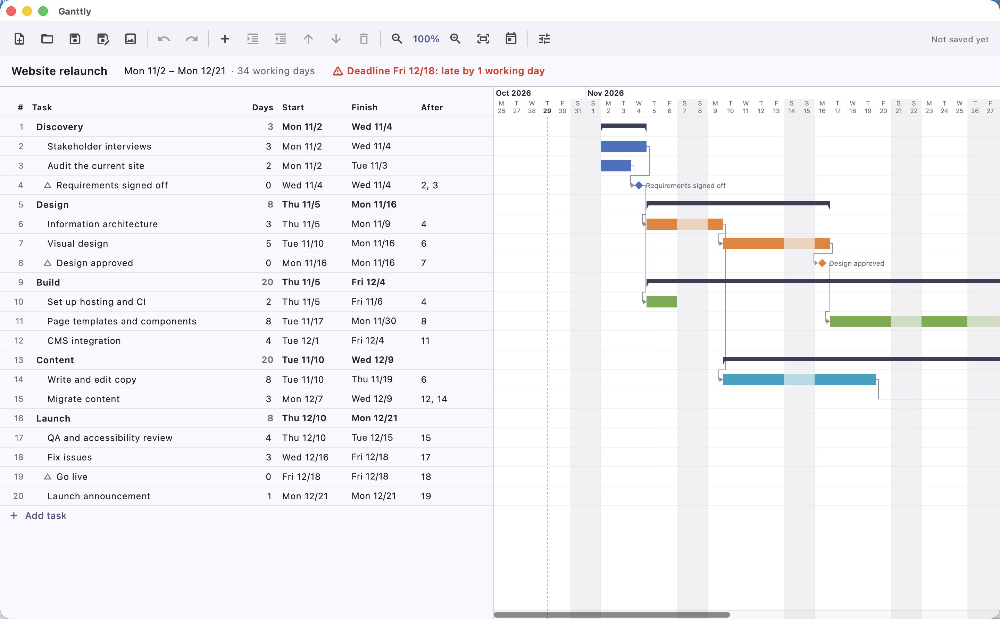

# Ganttly

A desktop project planner with a live Gantt chart. You edit tasks in a grid and the chart redraws as you type; you can save and open projects and export the whole chart as a PNG.

Built with Flutter for macOS, Windows and Linux.

## Repository layout

| Path | What's there |
|---|---|
| `src/` | The Flutter app (code, tests, platform runners) |
| `docs/` | Architecture, file format, roadmap, the original assessment |
| `scripts/` | Run, test, build and clean (below) |

## Run it

You need [fvm](https://fvm.app); the scripts use the Flutter version pinned in `src/.fvmrc` (3.44.0). Run them from anywhere:

| Script | What it does |
|---|---|
| `scripts/run.sh [platform]` | Runs the app from source (debug; in the terminal `r` hot-reloads, `q` quits). |
| `scripts/test.sh [path]` | Static analysis, then the tests (all, or one folder or file under `src/`). |
| `scripts/build.sh [platform]` | A release build; prints where the app is. |
| `scripts/clean.sh` | Deletes build output and re-fetches packages, for a build in a strange state. |

`platform` is `macos`, `windows` or `linux`; it defaults to the machine you're on (each platform builds only on its own OS). macOS needs 12 or later. Release builds for macOS are Apple Silicon only for now (see [docs/architecture.md](docs/architecture.md#platform-notes)).

To use Flutter directly: `cd src && fvm flutter <command>`.

## Using it

The app reopens the last project you opened or saved. On a first start (or if that file has been moved or deleted) it shows a sample plan, "Website relaunch", an ordinary `.ganttly` file bundled with the app (`src/assets/samples/`). New starts an empty project.

- **Grid:** click a cell to edit; Enter or clicking away saves it. An invalid entry flashes red and goes back.
  - **Days:** working days. `0` makes a milestone.
  - **Start:** shows the worked-out start. Typing a date (`11/16`, `2026-11-16`) pins it: the task starts no earlier than that. Clear it to unpin. Pinned starts are shown in blue with a pin.
  - **After:** predecessor task numbers, e.g. `2, 5+3` (after task 2, and 3 working days after task 5).
  - Indent a task under the one above to make that one a summary; its dates then come from the tasks under it.
- **Chart:** bars skip weekends and holidays; summaries are dark brackets; milestones are diamonds; arrows show links; the dotted line is today; the red column is the deadline. Click a row to select it.
  - **Scroll:** up and down with the wheel; sideways with the scrollbar at the bottom, the wheel over the date header, Shift + wheel, or a trackpad swipe.
  - **Zoom:** the toolbar's − / + buttons (the percentage between them resets to 100%), ⌘ + scroll wheel over the chart (zooms where the pointer is), or Fit to see the whole plan.
- **Project settings** (sliders icon): name, start date, deadline, holidays.

Shortcuts (⌘ on macOS, Ctrl elsewhere): N new, O open, S save, ⇧S save as, E export PNG, Z / ⇧Z undo / redo, Enter add task below, ] / [ indent / outdent, ⇧↑ / ⇧↓ move, ⌫ delete, = / − zoom, 0 zoom to 100%.

Projects are saved as `.ganttly` files (JSON; see [docs/file-format.md](docs/file-format.md)).
